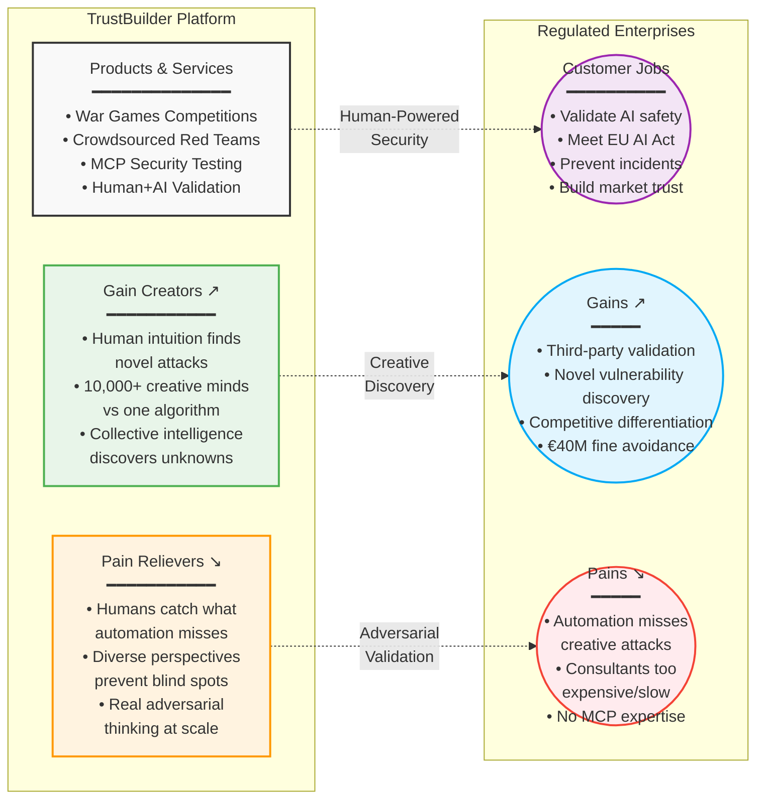

# TrustBuilder AI: Value Proposition Canvas
## Human Intuition in AI Security

---

## Version 1: Mermaid Diagram



---

## Version 2: ASCII Art Canvas

```
┌─────────────────────────────────────────┬─────────────────────────────────────────┐
│        TRUSTBUILDER PLATFORM            │        REGULATED ENTERPRISES            │
├─────────────────────────────────────────┼─────────────────────────────────────────┤
│                                         │                                         │
│         GAIN CREATORS ↗                 │              GAINS ↗                    │
│  ┌─────────────────────────────┐       │    ┌──────────────────────────┐        │
│  │ • Human intuition finds     │       │    │ • Third-party validation │        │
│  │   novel attacks              │       │    │ • Novel vulnerability    │        │
│  │ • 10,000+ creative minds    │═══════╪═══▶│   discovery              │        │
│  │   vs one algorithm          │       │    │ • Competitive edge       │        │
│  │ • Collective intelligence   │       │    │ • €40M fine avoidance    │        │
│  │   discovers unknowns        │       │    └──────────────────────────┘        │
│  └─────────────────────────────┘       │                                         │
│                                         │                                         │
│      PRODUCTS & SERVICES               │          CUSTOMER JOBS                  │
│  ┌─────────────────────────────┐       │    ┌──────────────────────────┐        │
│  │ • War Games Competitions    │       │    │ • Validate AI safety     │        │
│  │ • Crowdsourced Red Teams    │═══════╪═══▶│ • Meet EU AI Act         │        │
│  │ • MCP Security Testing      │       │    │ • Prevent incidents      │        │
│  │ • Human+AI Validation       │       │    │ • Build market trust     │        │
│  └─────────────────────────────┘       │    └──────────────────────────┘        │
│                                         │                                         │
│        PAIN RELIEVERS ↘                 │              PAINS ↘                    │
│  ┌─────────────────────────────┐       │    ┌──────────────────────────┐        │
│  │ • Humans catch what         │       │    │ • Automation misses      │        │
│  │   automation misses         │═══════╪═══▶│   creative attacks       │        │
│  │ • Diverse perspectives      │       │    │ • Consultants too        │        │
│  │   prevent blind spots       │       │    │   expensive/slow         │        │
│  │ • Real adversarial thinking │       │    │ • No MCP expertise       │        │
│  │   at scale                  │       │    └──────────────────────────┘        │
│  └─────────────────────────────┘       │                                         │
│                                         │                                         │
└─────────────────────────────────────────┴─────────────────────────────────────────┘

KEY DIFFERENTIATOR: "Human intuition discovers tomorrow's vulnerabilities today"
```

---

## Version 3: Structured Markdown

### 🎯 **Core Value Proposition**
> **"Human intuition discovers tomorrow's vulnerabilities today"**
> 
> While automated tools pattern-match against yesterday's attacks, TrustBuilder's 10,000+ security researchers use creativity, intuition, and adversarial thinking to discover the novel vulnerabilities that will define tomorrow's threats.

---

### 🏢 **TRUSTBUILDER PLATFORM**

#### 📦 Products & Services
- **🎮 War Games Competitions**: Gamified security challenges that motivate thorough testing
- **👥 Crowdsourced Red Teams**: 10,000+ vetted security researchers thinking adversarially
- **🔧 MCP Security Testing**: First platform addressing Model Context Protocol risks
- **🤝 Human+AI Validation**: Combining human creativity with automated scale

#### ⬆️ Gain Creators
- **🧠 Human intuition finds novel attacks**: Discovers vulnerabilities automation can't imagine
- **🌍 10,000+ creative minds vs one algorithm**: Diverse perspectives uncover blind spots
- **💡 Collective intelligence discovers unknowns**: Community learning improves over time

#### ⬇️ Pain Relievers  
- **👁️ Humans catch what automation misses**: Creative thinking beats pattern matching
- **🔍 Diverse perspectives prevent blind spots**: Global researchers with varied backgrounds
- **⚔️ Real adversarial thinking at scale**: Actual human adversaries, not simulations

---

### 🏛️ **REGULATED ENTERPRISES**

#### 💼 Customer Jobs
- **✅ Validate AI safety**: Prove models are secure before deployment
- **📋 Meet EU AI Act**: Achieve compliance with €40M penalty regulations
- **🛡️ Prevent incidents**: Stop breaches before they happen
- **🤝 Build market trust**: Earn customer confidence through validation

#### ⬆️ Gains
- **🏆 Third-party validation**: Independent security certification
- **🔮 Novel vulnerability discovery**: Find unknown unknowns
- **🚀 Competitive differentiation**: "TrustBuilder Validated" seal
- **💰 €40M fine avoidance**: Regulatory compliance assurance

#### ⬇️ Pains
- **🤖 Automation misses creative attacks**: Pattern-based tools can't think adversarially
- **💸 Consultants too expensive/slow**: $500K+ projects with 3-month timelines
- **❓ No MCP expertise**: Emerging risks in tool-calling AI

---

### 🎯 **The Human Advantage**

| Automated Testing | Human Red Teaming |
|------------------|-------------------|
| Finds known patterns | Discovers novel attacks |
| Predictable approach | Creative thinking |
| Single perspective | Diverse viewpoints |
| Static rules | Adaptive strategies |
| Past vulnerabilities | Future threats |

---

### 💬 **Key Messages**

#### For Security Leaders
> "Your AI faces human adversaries. Test it with human defenders."

#### For Compliance Officers  
> "Regulatory compliance requires thinking beyond the checklist."

#### For Executives
> "In the AI trust economy, human validation is your competitive edge."

---

### 🏆 **Why Human Intuition Wins**

1. **The Alex O'Connor Example**: A human convinced GPT-3.5 that God exists through creative dialogue - no algorithm would have found this vulnerability

2. **Novel Attack Vectors**: Humans combine unrelated concepts to create new attack patterns automation can't predict

3. **Context Understanding**: Humans grasp nuanced business logic flaws that pure technical scanning misses

4. **Adaptive Thinking**: As AI defenses improve, human testers adapt strategies in real-time

5. **Psychological Insight**: Understanding how to manipulate AI requires human understanding of persuasion and deception

---

### 📊 **The Numbers**

- **3x** more critical vulnerabilities found vs. automated tools
- **10,000+** security researchers in the network
- **60%** lower cost than traditional consulting
- **75%** faster compliance achievement
- **€40M** potential fine avoidance

---

### 🚀 **Call to Action**

**"Don't let algorithms defend against human attackers. Harness human intuition to secure your AI."**

Join the leaders who understand that in the battle for AI security, human creativity is the ultimate weapon.

---

*TrustBuilder AI: Where Human Intuition Meets AI Security*